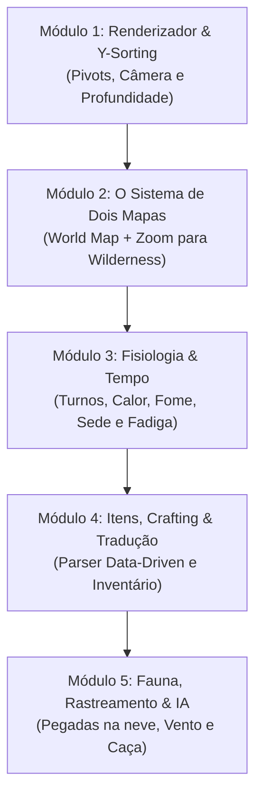

# 🗺️ Planejamento Geral do Projeto: UnReal World Reborn

> **Documento Vivo de Planejamento e Arquitetura**  
> *Todas as decisões, discussões, ideias e roteiros de implementação serão centralizados e atualizados continuamente aqui.*

---

## 1. Visão Geral & Filosofia

* **Objetivo:** Criar uma re-implementação moderna, robusta e independente do simulador de sobrevivência roguelike *UnReal World*, ambientado na Idade do Ferro nórdica/finlandesa.
* **Filosofia do Motor:**
  * **C# Puro (.NET 9):** Focado em simulação lógica pesada, arquitetura limpa e testes, sem a sobrecarga ou rigidez de engines de 20 GB (Unity/Unreal).
  * **Assets Próprios:** Construir nossa própria biblioteca de sprites, áudios e dados, tornando o projeto 100% autônomo e de código aberto.
  * **Data-Driven & Modding:** Separação estrita entre lógica do motor e dados (itens, receitas, biomas e textos ficam em arquivos legíveis e fáceis de editar).
  * **Localização Nativa:** Suporte de primeira classe a múltiplos idiomas (com **Português do Brasil - PT-BR** como prioridade nativa, sem limites de bytes de binário).
  * **Controles Híbridos:** Manter os clássicos atalhos numéricos de 8 direções do roguelike, combinados com suporte fluido a mouse (clique para andar, arrastar itens no inventário).

---

## 2. Decisões de Arquitetura Tomadas (Log de Decisões)

| Data | Decisão | Motivação |
| :--- | :--- | :--- |
| **14/10/2026** | **Tech Stack:** C# (.NET 9) + Raylib-cs | Desempenho nativo com aceleração de GPU, inicialização instantânea, código 100% puro sob nosso controle. |
| **14/10/2026** | **Ambiente Seguro:** Pasta `./urw_reborn/` | Isolamento total para não alterar nem corromper a instalação do jogo original. |
| **14/10/2026** | **Assets Próprios:** PNGs 32-bit RGBA | Geração de sprites com IA, processamento de canal alfa com Python/Pillow e filtragem bilinear no renderizador. |
| **14/10/2026** | **Início com Dois Níveis de Mapa:** World Map + Wilderness | Preservar a essência de viagem continental e exploração local do URW. |
| **15/10/2026** | **Inventário Espacial Unificado:** `SpatialItems` é a fonte única (Backpack legado removido); CookingSystem consome/produz direto no grid; starter-kit real; persistência em `save_inventory.txt`; capacidade de peso derivada da Força (1.8 kg/pt) | Fonte de verdade única; sem itens demo; estado sobrevive a restart; validado por `--selftest` |
| **15/10/2026** | **Kit de UI Moderno `UiTheme.cs`:** fontes TTF Segoe UI/Arial (LoadFontEx), paleta dashboard, helpers Panel/Header/Label/StatBar; aplicado na sidebar, inventário, mapa mundi, menu principal, culinária e menu de contexto | Fonte pixelada default do raylib aposentada; visual dashboard consistente em todas as telas |

---

## 3. Roteiro de Módulos (Roadmap de Desenvolvimento)

### 📍 Módulo 1: Renderizador 2D, Câmera e Y-Sorting (Fase Atual)
* [x] Janela nativa acelerada por GPU a 60 FPS com redimensionamento.
* [x] Carregamento de sprites próprios transparentes.
* [ ] **Pivots e Ancoragem por Base:** Definir a base dos pés do personagem e da raiz das árvores como ponto de fixação nos tiles.
* [ ] **Y-Sorting (Ordenação de Profundidade):** Desenhar entidades ordenadas pelo eixo Y inferior, para que o jogador possa andar na frente ou atrás de árvores sem falhas visuais.
* [ ] **Câmera 2D Suave com Margens (Padding):** Evitar que árvores nas bordas do mapa sejam cortadas pela margem da tela.
* [ ] **Proporções de Grid Padronizadas:** Normalizar as escalas de itens pequenos (1x1), personagens (1x1.3) e árvores grandes (1.5x2.5 tiles).

### 📍 Módulo 2: O Sistema de Dois Níveis de Mapa (World Map -> Wilderness) (Implementado!)
* [x] **Geração Procedural do Mapa Mundi (Overworld):**
  * Ruído fractal de Altitude e Umidade gerando a massa continental da Fennoscândia.
  * 8 Biomas autênticos: *Taiga de Pinheiros*, *Bosque de Bétulas*, *Pântano / Turfeira (Mire)*, *Lagos/Rios*, *Cordilheira Rochosa*, *Colinas com Penhascos*, *Planícies de Musgo* e *Assentamentos Tribais*.
  * Tempo de viagem continental dinâmico por tipo de terreno (15 a 45 min/passo).
* [x] **Mecânica de "Zoom" e Transição Fluida:**
  * Tecla **[M]** ou botão na sidebar abre a visão continental do Mapa Mundi.
  * Tecla **[ENTER]** no Mapa Mundi dá o "zoom" e gera o setor local tático correspondente ao bioma.
  * Geração determinística por semente: `LocalSeed = Hash(WorldSeed, WorldX, WorldY)`.
  * Andar além da borda do mapa local retorna o jogador automaticamente ao mapa continental na direção correspondente!
* [x] **Persistência de Alterações (Delta Saves):**
  * Sistema de persistência em memória `LocalSectorDeltas`: árvores derrubadas, fogueiras acesas e alterações feitas em um setor são restauradas perfeitamente ao retornar àquele tile do mapa mundi.

### 📍 Módulo 3: Fisiologia Corporal e Tempo Contínuo
* [ ] Ciclo de tempo contínuo (minutos, horas, dias e 4 estações finlandesas com congelamento e degelo).
* [ ] Modelo térmico: temperatura ambiente, sensação térmica com vento e calor corporal.
* [ ] Camadas de roupas (*Layering System*): lã, linho, peles e couro com espessura e isolamento.
* [ ] Fome, sede, estafa e necessidade de sono.
* [ ] Anatomia de ferimentos (cortes, perfurações, ossos quebrados, sangramento e infecções graduais).

### 📍 Módulo 4: Inventário, Equipamentos & Sistema Espacial de Grade (Tetris / Tarkov)
* [x] **HUD de Personagem e Atributos Completos:**
  * Container do Ranger + 4 Barras de Sobrevivência (Fome, Sede, Energia, Saúde).
  * Painel com os 11 Atributos Oficiais do UnReal World em duas colunas.
  * Grid de Equipamentos 3x3 e Painel de Detalhes do Item Selecionado.
* [x] **Novo Sistema de Mochila Espacial em Grid (Inventory Tetris / Tarkov Style)** *(implementado e unificado ao jogo!)*
  * [x] **Dimensões Físicas dos Itens (Matriz W x H):**
    * *Itens pequenos (1x1):* Frutas silvestres, pedras, pederneira, anéis, dentes de urso, agulhas.
    * *Facas e ferramentas curtas (1x2 ou 2x1):* Faca de caça, faca de entalhe, tochas, cantil/odre.
    * *Machados e armas médias (2x3 ou 3x2):* Machado de lenhador, clava de guerra, escudo pequeno.
    * *Arcos e lanças (1x4 ou 4x1):* Arco longo de bétula, zagaia, arpão de pesca, remos.
    * *Peles e sacos de dormir (3x3 ou 2x4):* Pele de urso enrolada, saco de dormir de pele de foca.
    * *Panelas e recipientes (2x2):* Pote de barro, caldeirão de ferro, fardos de comida.
  * [x] **Mecânica de Arraste e Rotação 90° com Tecla [R]:**
    * Ao segurar um item com o botão esquerdo e arrastar, o jogador pode pressionar **`R`** para girar o item instantaneamente entre horizontal e vertical.
    * [x] **Feedback Visual de Colisão:**
      * Células iluminadas em **Verde Translúcido** se o espaço estiver desimpedido e dentro dos limites.
      * Células iluminadas em **Vermelho Translúcido** se houver sobreposição com outro item ou se passar da borda da mochila.
  * [x] **Informações Estilizadas sobre o Item (Inspiradas na Referência Visual):** *(peso/durabilidade/stack renderizados com fonte TTF no kit UiTheme)*
    * *Canto superior direito:* Peso em quilos (ex: `0.4kg`, `2.9kg`, `1.18kg`).
    * *Canto inferior direito:* Durabilidade / Condição percentual (ex: `95%`, `70%`).
    * *Canto inferior esquerdo (em amarelo):* Quantidade empilhada ou capacidade (ex: `1/75`, `x4`).
  * [ ] **Tamanho Dinâmico da Mochila pelo Equipamento:** *(pendente — grid ainda fixo 10x6; a API spatialCoordinates já suporta redimensionar)*
    * *Sem mochila (apenas bolsos da túnica):* Grade pequena 4x3 (12 células).
    * *Com bolsa de cintura/pouch:* + grade 3x2.
    * *Com Mochila de Couro Pequena:* Grade 7x5 (35 células).
    * *Com Mochila de Caçador (Alce/Lobo):* Grade 9x7 (63 células).

### 📍 Módulo 5: Fauna, Rastreamento e IA
* [ ] Pegadas na neve fresca e no musgo úmido que desaparecem com o tempo e com nevascas.
* [ ] Olfato e visão animal (vento soprando o cheiro do caçador em direção à presa).
* [ ] Armadilhas passivas (fossos, laços e alçapões).

### 📍 Módulo 6: Arquitetura Multiplayer / MMORPG & Menu Principal (Planejado & Em Execução)
* [ ] **Menu Principal Inicial (Atmospheric Title Screen):**
  * Opções: 🌲 **Um Jogador (Singleplayer)**, 🌐 **Multijogador (MMORPG / Rede)**, ⚙️ **Configurações**, ❌ **Sair**.
  * Tela de Conexão Multiplayer: Escolha de apelido (Nick), IP do Servidor, Porta e indicador de Ping / Status.
* [ ] **Desacoplamento Completo da Camada de Simulação (Client-Server):**
  * O código gráfico (Raylib) torna-se apenas o **Cliente (Visualizador / View)**.
  * O estado do mundo, mapa mundi, posições de jogadores e alterações locais passam a viver em uma camada isolada (**Server/Simulation Engine**).
  * **No Singleplayer:** O jogo inicia um servidor interno em memória e conecta o cliente local imediatamente.
  * **No Multiplayer / MMORPG:** O servidor roda como processo dedicado ou host de rede, permitindo múltiplos sobreviventes explorando o mesmo continente e os mesmos setores locais juntos!
* [ ] **Sincronização de Sobreviventes e Ações em Rede:**
  * Visualização de outros jogadores andando pelo mapa local e pelo mapa mundi.
  * Construções e fogueiras compartilhadas (o fogo aceso por um jogador aquece os outros jogadores ao redor).
  * Chat local e global na barra lateral.

### 📍 Módulo 7: Sistema Culinário, Botânica & Processamento Avançado (Fusão URW + BDO) [Implementado & Ativo!]
* [x] **Base de Dados BDO Completa Extraída:**
  * Script automatizado multithread `scripts/bdo_recipe_importer.py` e `scripts/enrich_bdo_recipes.py`.
  * Extração e identificação de 321 receitas culinárias (`bdo_culinary_recipes.json`) e 554 de processamento (`bdo_processing_recipes.json`), com 411 itens totalmente traduzidos e mapeados em `bdo_cooking_recipes_enriched_pt.json`.
* [x] **Motor Culinário Nórdico Hiper-Detalhado (`CookingSystem.cs`):**
  * **Sistema de Tags e Substituição Dinâmica:** Receitas não exigem apenas IDs fixos, aceitam famílias de ingredientes (`Mushroom_Edible`, `Meat_Quadruped`, `Cereal_Flour`, `Liquid_Broth`, `Seasoning_Salt`), permitindo usar carne de alce, urso ou rena intercambiavelmente.
  * **Química e Física Primitiva:**
    * Extração de sal por evaporação de água salina na fogueira.
    * Neutralização de toxinas: cogumelos venenosos (falsa-morchella/orelha-negra) requerem fervura dupla e descarte da água tóxica para virarem alimento seguro.
    * Batedura mecânica de leite em manteiga salgada + soro de leite.
    * Moagem por atrito de pedras (quern) de centeio e cevada em farinhas rústicas.
    * Caldos lentos de ossos partidos e tutano com liberação de colágeno.
  * **Hierarquia de 4 Tiers Gastronômicos:**
    1. *Tier 0 (Botânica & Coleta Bruta):* Bagas, ervas, cogumelos com e sem veneno, água salina/doce, carnes frescas.
    2. *Tier 1 (Processamento Básico):* Moer, secar, salgar, bater leite, ferver/esterilizar.
    3. *Tier 2 (Bases & Molhos):* Salmoura, caldo de tutano, manteiga de ervas da bétula, massa azeda sourdough.
    4. *Tier 3 (Sopas, Pães & Assados):* Sopa boreal de cogumelos com folhas de bétula, ensopado de alce, Lohikeitto (sopa de salmão com nata), pão chato na pedra (Rieska).
    5. *Tier 4 (Grandes Banquetes):* "Banquete dos Caçadores da Taiga" (combina múltiplos pratos prontos e concede buffs lendários como "Sangue de Ferro" - imunidade a hipotermia e calor contínuo).
* [x] **Interface Gráfica de Culinária (`CookingHUD.cs`):**
  * Atalho universal `C` ou clique com botão direito na Fogueira (`Fireplace`) ou no Solo.
  * Filtro por categorias com tabs estilizadas.
  * Painel de verificação de ingredientes em tempo real (bolinhas verdes se possui todos os itens, vermelhas se faltam).
  * Painel de efeitos fisiológicos imediatos (Calor 🔥, Nutrição 🍖, Hidratação 💧, Energia ⚡).
  * Consumo automático de ingredientes da mochila e empilhamento dos produtos finais preparados.

---

## 4. Banco de Ideias em Aberto (Backlog de Discussões)

* **Iluminação e Fogueiras:** Ciclo visual dia/noite e iluminação dinâmica suave ao acender tochas ou fogueiras à noite na neve.
* **Economia e Trocas Tribais (Trading):** Negociação de peles de animais, machados de ferro e alimentos com aldeões NPC e outros jogadores.
* **Clãs e Tribos de Jogadores (MMO):** Possibilidade de jogadores fundarem aldeias e cabanas compartilhadas na taiga.

---

> *Este arquivo será mantido e expandido a cada nova discussão e implementação do projeto.*

